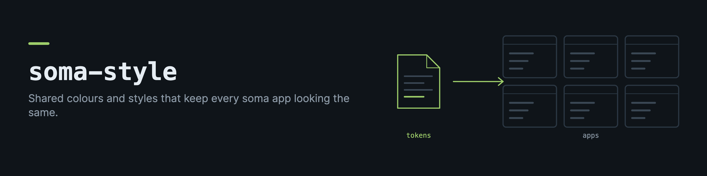

# soma-style

Shared design tokens for the soma ecosystem. One source of truth for macro colors, the chart palette, and the Tailwind v4 theme, so soma and the standalone macro-engine / hevy2garmin / garmin-auth UIs all render the same palette instead of each copy-pasting hex values.


## Install

```bash
npm install soma-style
```

## The tokens


| Macro    | Hex       | Tailwind      | CSS var            |
| -------- | --------- | ------------- | ------------------ |
| protein  | `#B17850` | `warm`        | `--macro-protein`  |
| carbs    | `#6366B0` | `indigo`      | `--macro-carbs`    |
| fat      | `#CBE896` | `lime`        | `--macro-fat`      |
| calories | `#77C8D1` | `teal`        | `--macro-calories` |
| fiber    | `#82D0C8` | `teal-light`  | `--macro-fiber`    |

Status colors (`success` / `warning` / `danger`) back the `progressColor` and `deficitColor` helpers.

## Use it

### TypeScript tokens

```ts
import { MACRO_COLORS, progressColor, deficitColor, ChartColors } from "soma-style/colors";

MACRO_COLORS.protein.hex;    // "#B17850"
MACRO_COLORS.protein.bg;     // "bg-warm"          (Tailwind class, needs theme.css)
MACRO_COLORS.protein.cssVar; // "--macro-protein"  (needs tokens.css)

progressColor(102);          // "text-success"
deficitColor(450, 500);      // "text-warning"
```

### Tailwind v4 apps

Import the theme after Tailwind. `base.css` is the whole app theme (surface + brand + chart tokens, dark/light, teal primary); `theme.css` adds the macro + status colors:

```css
@import "tailwindcss";
@import "soma-style/base.css";
@import "soma-style/theme.css";
```

Now the shadcn-style tokens (`bg-background`, `bg-card`, `text-primary`, `bg-chart-1`, …) and the macro classes (`bg-warm`, `text-indigo`, `bg-teal`, `text-success`, …) all resolve to the ecosystem palette. If you reference the classes indirectly (via `MACRO_COLORS`), add a `@source` so Tailwind still generates them:

```css
@source "../node_modules/soma-style/dist";
```

### Non-Tailwind apps

Import the plain CSS variables and reference them directly:

```css
@import "soma-style/tokens.css";
```

```css
.protein { color: var(--macro-protein); }
```

### React Native components

The main entry (`soma-style`) is a small React Native UI kit (`Text`, `Button`, `Card`, `Pill`, `Ring`, `Sparkline` and others). It needs `react`, `react-native`, `react-native-svg` and `nativewind`. The last three are optional peer dependencies, so a web app that uses only the CSS files and `soma-style/colors` does not install React Native.

## Develop

```bash
npm run build   # tsc → dist/
npm test        # vitest
```
